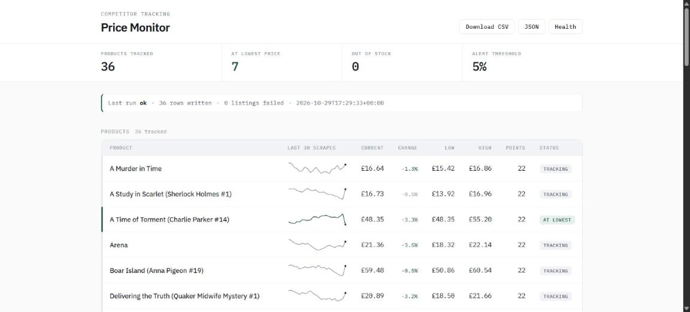

# Competitor Price Monitor

Scrapes product prices on a schedule, stores the history, flags drops and
back-in-stock events, and serves a dashboard plus CSV/JSON export.



Built against [books.toscrape.com](https://books.toscrape.com), a sandbox
published for scraper testing. Pointing it at a different shop is a config
change, not a code change.

## Run it

```bash
python -m venv .venv && .venv/Scripts/activate   # Linux/macOS: source .venv/bin/activate
pip install -r requirements.txt
python run_scrape.py        # scrape once
python seed_demo.py         # optional: synthetic history so the dashboard isn't flat
uvicorn app.main:app --reload
```

Then open http://127.0.0.1:8000. Every product row carries an inline
sparkline of its last 30 scrapes, so a trend is visible without clicking
anything.

## Tests

```bash
pytest -q
```

Fifteen tests. Most of them are about money parsing, because that is where
this class of tool quietly gets it wrong: `"1,234.56"` and `"1.234,56"` are
both common and a naive `float()` turns the first into `1.23`. The rest cover
link resolution, per-item stock state, and the important one — a selector that
matches nothing raises instead of writing zero rows and reporting success.

## Schedule it

```cron
*/30 * * * *  cd /srv/price-monitor && .venv/bin/python run_scrape.py >> scrape.log 2>&1
```

`run_scrape.py` exits non-zero when a target produced no rows, so cron, a
systemd timer or a CI scheduler can alert on a failed run.

## Configuration

Everything lives in `app/config.py` and can be overridden by environment
variable:

| Variable | Default | Meaning |
|---|---|---|
| `PRICE_MONITOR_DB` | `price_monitor.db` | SQLite file path |
| `PRICE_MONITOR_DELAY` | `1.0` | Seconds between requests to a host |
| `PRICE_MONITOR_DROP` | `0.05` | Alert threshold, as a fraction |
| `PRICE_MONITOR_WEBHOOK` | *(unset)* | POST alerts here; Slack incoming webhooks work as-is |

A new shop is a new entry in `TARGETS`:

```python
{
    "key": "example-shop",
    "label": "Example Shop",
    "listing_urls": ["https://example.com/category/widgets"],
    "selectors": {
        "item": "div.product-card",
        "name": "h2.title",
        "price": "span.price",
        "stock": "span.availability",
        "link": "a.product-link",
        "link_attr": "href",
    },
    "currency": "EUR",
}
```

## Endpoints

| Route | Returns |
|---|---|
| `/` | Dashboard |
| `/api/products` | Every product with its latest price, min, max, sample count |
| `/api/products/{id}/history` | Price points for one product |
| `/export.csv` | Flat CSV of every price point |
| `/healthz` | Status of the last run, for uptime monitoring |

## Design notes

These are the decisions that separate a scraper that survives from one that
quietly rots:

- **Prices are integer minor units.** Floats drift; a client comparing the
  dashboard against their own spreadsheet notices.
- **Both decimal conventions parse correctly.** The decimal mark is whichever
  of `.` or `,` comes last *and* is followed by one or two digits; everything
  else is a grouping mark. `£1,234.56` and `1.234,56 €` both give 123456.
- **A zero-match selector raises.** If the markup changes, the run is marked
  `failed` rather than writing nothing and reporting success. Silent zero-row
  runs are the most common way this class of tool fails unnoticed.
- **Run status is judged per listing page, not per row.** One failed page out
  of two means half the catalogue is missing; counting that against 36
  successful rows would call the run healthy. A partial run says `partial`.
- **The dashboard reads the whole series in one query.** A window function
  pulls the last 30 points for every product at once instead of one query per
  row, so the page stays fast with a few hundred products.
- **Retry with exponential backoff**, and `Retry-After` is honoured on 429.
- **A per-host delay** between requests.
- **Undelivered alerts stay queued.** A webhook outage doesn't lose them; the
  next run retries.
- **Run history is persisted**, so `/healthz` can answer "did this actually
  work last night".

## Layout

```
app/config.py                 targets and settings
app/db.py                     SQLite schema and queries
app/scraper.py                fetch, retry, parse
app/alerts.py                 drop/restock detection and webhook delivery
app/main.py                   FastAPI dashboard and API
app/templates/dashboard.html  the dashboard
run_scrape.py                 scheduled entry point
seed_demo.py                  synthetic history for demos
tests/                        pytest suite
```

## Verified

Run on 2026-10-29, Python 3.13.1: `pytest -q` → 15 passed. 36 products scraped
from two live category pages, 0 failures. Dashboard (36 sparklines rendered),
JSON API, CSV export and `/healthz` all returning 200, no server errors.
